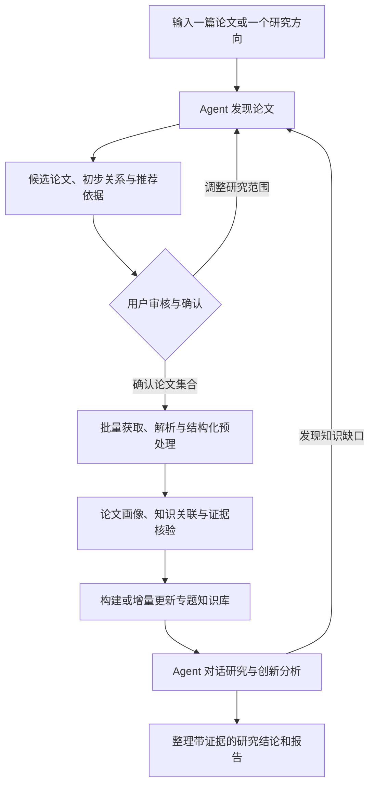

# DeepInsight

**面向技术论文创新洞察的 Agent 智能研究平台**

## 一、核心目标

**帮助技术研究人员、架构师和技术规划人员，从多篇论文得出可核验的技术判断。** 用户从一篇论文或一个研究方向出发，就能梳理有哪些技术路线、各项工作改进了什么、哪些结论可以比较，以及哪些问题值得进一步验证。

以「KV Cache 管理方法如何演进」为例，一份可用于技术调研的成果应包含**方法演进图、方案对比矩阵和待验证问题清单**。用户可以沿图谱查看每条继承或改进关系的原文依据，在矩阵中看到性能结论适用的实验条件，并了解哪些已有工作可能影响下一步研究判断。

| 产品能力 | 在研究中的作用 |
| --- | --- |
| **理解论文之间的技术关系（核心）** | 对齐多篇论文的研究问题、技术方法和创新贡献，梳理引用、继承、改进及比较关系 |
| 找到论文与原文内容 | 建立专题论文范围，并定位支撑分析的方法、公式、实验结果和局限 |
| 追踪作者与团队 | 沿论文和方法追踪作者成果、机构合作与研究方向演进 |

## 二、业界现状与待解决的问题

学术搜索工具已支持文献发现和引用网络查询，AI 文献综述工具也已支持论文筛选、结构化数据提取及带引文的证据综合。[Semantic Scholar 产品说明](https://webflow.semanticscholar.org/product) · [Elicit 系统综述工作流](https://elicit.com/solutions/systematic-review)

DeepInsight 聚焦技术调研中从**找到相关研究**走到**判断技术路线**的环节。以「某种推理加速方法是否值得纳入架构选型」为例，研究人员需要逐项核对方法机制、对照基线和实验条件，再说明每条结论在什么范围内成立。硬件、模型规模、数据集和指标口径的差异都会影响比较。NeurIPS 论文检查清单也明确要求说明实验设置、计算资源和结论适用范围。[NeurIPS 论文检查清单](https://neurips.cc/public/guides/PaperChecklist)

| 用户遇到的问题 | 对研究决策的影响 | DeepInsight 的解决方向 |
| --- | --- | --- |
| **难确认技术继承与改进。** 引用和术语相似提供线索，实际关系需要核对方法和贡献。 | 难判断一项工作改进了哪种机制，也容易把不同路线归为同一分支。 | 对齐研究问题和方法，核验继承、改进和实验比较关系，逐条关联原文证据。 |
| **难判断实验结果是否可比。** 论文可能使用不同模型、硬件、数据集、基线或指标。 | 性能数字容易被带入不适用的选型场景。 | 抽取并对齐实验条件，明确哪些结果可以比较、结论适用的范围和证据冲突。 |
| **难判断研究机会是否已有工作覆盖。** 论文局限、后续改进和反例散落在不同来源中。 | 容易重复投入，或过早把候选方向当作已证实的创新。 | 结合已有工作、研究局限和反证检索提出候选机会，列出支持证据、反证与待验证条件。 |
| **研究范围扩大后，分析难以复用。** 新论文可能补齐缺失路线，也可能改变原来的结论。 | 每轮调研都可能重复梳理论文、关系和证据。 | 将经用户确认的论文、技术关系和证据沉淀到专题知识库。补充论文后，增量更新受影响的索引和关系，供用户复查相关结论。 |

产品优先兑现的体验是：用户从同一个专题中回答「谁改进了谁」「在什么条件下有优势」「还需要验证什么」，并能打开支撑每项判断的原文位置。

## 三、用户使用范式

用户提供一篇论文或一个技术研究方向，通过「发现 → 确认 → 治理 → 对话 → 持续补充」推进研究。

### 3.1 论文发现

- **论文入口。** 上传 PDF，或输入论文标题、DOI、URL。Agent 从种子论文出发发现引用、被引用及技术相关论文。
- **方向入口。** 输入「KV Cache 优化」等研究主题。Agent 结合研究问题、方法和时间范围组织查询，扩展候选论文。
- **用户确认。** 系统展示论文列表、初步引用或相似关系及推荐理由。用户可以选择、排除或补充论文，也可以要求 Agent 继续扩展候选。确认后的论文进入专题待治理集合。

发现阶段优先使用外部学术索引、元数据、摘要和引用网络。用户确认是启动批量全文获取、深度解析和知识入库的前提。

### 3.2 知识治理

系统对确认后的论文异步执行批量治理，用户可查看进度、重试失败任务，以及审核、修正或重新治理已处理的知识。

1. **获取与解析。** 下载可合法获取的全文，去重并管理版本，解析标题、摘要、章节、公式、图表、参考文献和附录。无法获取全文时保留元数据并记录处理状态。
2. **预处理与画像。** 清洗内容并生成结构化 Markdown、章节索引和语义切片，保留原文位置映射。提取研究问题、技术方法、创新贡献、实验设置、结论和局限。
3. **知识关联。** 构建领域分类、技术概念以及论文、方法、作者和机构之间的关系。为引用、继承、改进、比较和问题相似等关系保留类型、依据及核验状态，区分可确认的事实、抽取的候选知识和待核验推断。
4. **索引与溯源。** 构建元数据、全文、向量、结构和关系索引，保留 `Source → Evidence → Claim` 证据链，使研究结论可以回溯到论文及其原文位置。

专题知识库包含领域知识树、多维分面、技术关系图谱和支持混合检索的证据索引。原始 PDF 与结构化知识分别保存，支持后续审核、修订和增量更新。

### 3.3 对话研究

Agent 在专题范围内结合混合检索、图谱遍历和证据核验开展多轮研究。

| 用户提问 | 预期输出 |
| --- | --- |
| 这些论文分别研究什么？哪些是核心文章？ | 论文列表、研究方向分类、摘要和引用 |
| 哪些方法是在 PagedAttention 基础上改进的？ | 可核验的技术继承与改进关系，以及对应的原文位置 |
| KV Cache 管理方法是如何演进的？ | 方法演进时间线、技术关系图和相关论文 |
| 这些方案的创新点和实验结果有哪些差异？ | 方法对比矩阵、实验条件、可比范围和不可比项说明 |
| 当前研究还存在哪些局限？ | 已有工作覆盖范围、未解决问题、候选研究方向和待验证假设 |
| 哪些专家持续研究相关技术？ | 专家成果、研究方向演进和团队合作网络 |

对话中发现知识缺口时，Agent 可以重新搜索文献并推荐新增论文。经用户确认后，系统治理新增论文，并更新受影响的索引和关系。研究成果可沉淀为带证据的技术对比报告、创新洞察报告、知识图谱或可复用的研究专题。

## 四、目标技术架构

以下是 V3.0 重构的目标架构。论文发现、知识治理和对话研究是贯穿四层架构的业务链路。

| 层级 | 职责 | 主要模块或数据 |
| --- | --- | --- |
| Agent 论文发现与研究交互层 | 理解、规划和推进研究任务，提供论文审核与对话入口 | 种子论文与研究方向查询、外部学术检索、候选关系与推荐、专题确认、研究问答、创新洞察与增量补充 |
| 论文知识治理层 | 将已确认的论文异步转化为可核验的结构化知识 | 下载去重与版本管理、PDF 解析、清洗与语义切片、论文画像、实验信息抽取、领域上下文、跨论文关联、证据与质量核验 |
| 多维知识组织与检索层 | 组织科研知识对象及其关系，为 Agent 提供检索和证据 | 领域树（Tree）、多维分面（Facet）、技术关系图谱（Graph）、作者和机构关系、章节结构索引、混合检索与重排、主张与证据链（Claim–Evidence） |
| 数据与存储层 | 持久化原始文档、结构化知识、关系、索引及研究状态 | 原始 PDF 和解析文件、论文元数据及画像、研究问题与方法贡献、作者与机构、关系和原文证据、各类检索索引、专题集合及处理任务状态 |

### 两项架构决策

1. **按阶段使用不同的数据粒度。** 发现阶段优先使用元数据、摘要、引用网络和轻量语义信息，控制查询延迟与处理成本。用户确认后，治理阶段使用全文及其结构化内容构建知识对象、证据和跨论文关系。
2. **在文本索引之外构建论文知识链。** 以 PDF 解析、Markdown、语义切片和向量索引为基础，进一步形成「论文画像 → 研究问题 → 技术方法 → 创新贡献 → 原文证据 → 跨论文关系」。跨论文关系先作为候选生成，再依据原文证据核验。系统区分可直接确认的事实、模型抽取的候选知识和未经核验的推断，并在检索和研究输出中保留这些区别。

## 五、Issue 规划

证据可信性贯穿各 Epic。每项 Issue 的详细验收应包含具体输入、预期输出、异常场景、准确性指标和可复现测试数据。

| Epic | Issue | 交付能力 | 核心验收 |
| --- | --- | --- | --- |
| A · 论文发现 | DI-01 | 种子论文与研究方向查询 | 两种入口均可检索并返回论文 |
| A · 论文发现 | DI-02 | 多策略相关论文发现 | 返回多种相关关系与推荐依据 |
| A · 论文发现 | DI-03 | 用户确认与专题管理 | 可选择、排除、补充论文并保存确认集合 |
| B · 知识治理 | DI-04 | 论文批量下载与任务管理 | 可查看成功、失败及重试状态 |
| B · 知识治理 | DI-05 | PDF 解析与结构索引 | 保留章节、公式、图表及原文位置映射 |
| B · 知识治理 | DI-06 | 论文画像与知识抽取 | 结构化提取研究问题、方法和贡献 |
| B · 知识治理 | DI-07 | 多维知识体系构建 | 生成领域分类、技术概念和论文关系 |
| B · 知识治理 | DI-08 | 跨论文技术关系构建 | 关系证据可回溯，可区分已核验关系和候选关系 |
| B · 知识治理 | DI-09 | 检索索引及增量更新 | 新增论文可检索，受影响的关系随之更新 |
| C · Agent 研究 | DI-10 | 专题论文问答 | 返回相关论文、具体内容和证据引用 |
| C · Agent 研究 | DI-11 | 技术关系查询与可视化 | 可查询方法级关系及其关联论文 |
| C · Agent 研究 | DI-12 | 跨论文创新差异分析 | 输出可核验的技术方法对比 |
| C · Agent 研究 | DI-13 | 专家研究关系分析 | 可查询作者、论文和研究方向之间的关系 |
| C · Agent 研究 | DI-14 | 创新机会分析 | 输出潜在研究机会与依据，支持反证检查 |
| C · Agent 研究 | DI-15 | 研究成果输出 | 生成带论文证据的专题研究报告 |

## 六、分阶段交付

1. **打通专题研究全流程。** 从一篇论文或一个技术方向出发，完成论文发现、用户确认、异步治理和有证据引用的专题问答，以端到端流程验收。
2. **交付跨论文关系与创新对比。** 完善研究问题和方法级知识抽取、技术关系核验及实验条件对齐，支持通过对话分析创新差异和技术演进。
3. **交付创新洞察与持续研究。** 支持研究局限分析、候选创新机会及反证核验，完善专题增量更新，将多轮研究沉淀为可复用的专题和报告。
